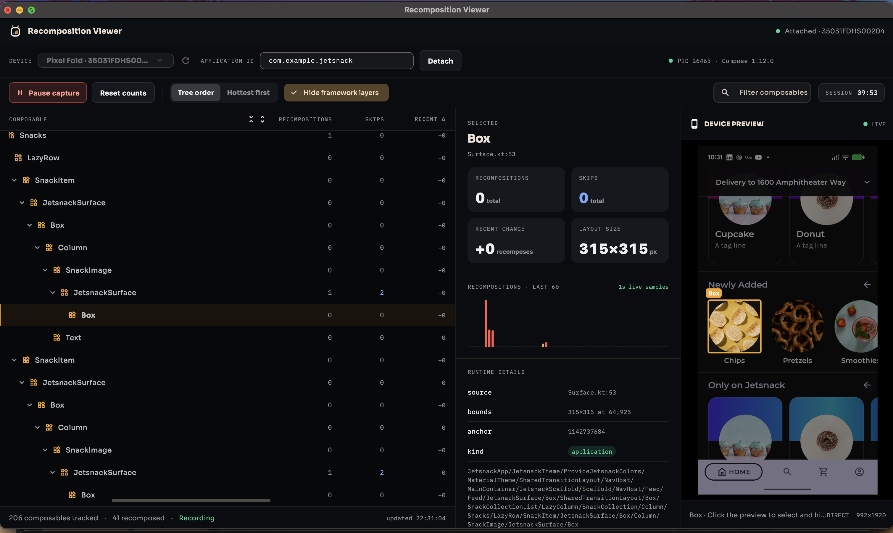
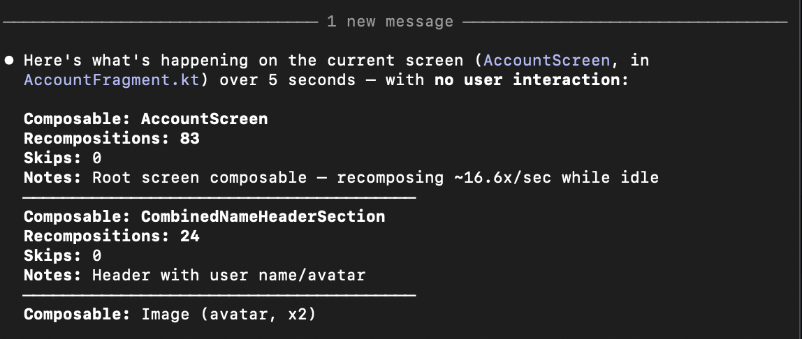

<div align="center">

# Recomposition Viewer

Live Jetpack Compose recomposition counts, hierarchy inspection, and device
preview—without opening Android Studio.

[Installing](#installing) · [Getting started](#getting-started) ·
[Architecture](docs/ARCHITECTURE.md) · [Contributing](CONTRIBUTING.md) ·
[Security](SECURITY.md)



</div>

Recomposition Viewer is an macOS desktop tool for understanding
which composables recompose or skip while you interact with a debuggable Android
app. It uses Android's device-side UI Inspector protocol and a persistent ADB
connection, so the inspected app does not need a debug overlay or an additional
instrumentation dependency.

## What it does

- Attaches to the foreground debuggable Compose app and starts capture
  automatically.
- Shows the complete reported Compose hierarchy with per-node recomposition,
  skip, and recent-delta counts.
- Filters framework wrappers while retaining useful `Text` and `Image` leaves.
- Expands, collapses, searches, and reveals deeply nested nodes.
- Streams a low-latency scrcpy preview beside the hierarchy.
- Selects the closest composable when you click the preview and highlights the
  selected node's physical bounds.
- Refreshes changed roots and recovers interrupted inspector sessions.
- Exposes the same inspection backend as an optional Codex MCP plugin.

## Installing

Set up the CLI and its agent skill first, then install the macOS app — the
two don't depend on each other at install time, so it's fine to grab only one.

### 1. Install the CLI and skill

```sh
curl -fsSL https://raw.githubusercontent.com/balvinderz/recomposition_viewer/main/cli/install.sh | bash
```

This installs `recomposition-inspector` onto `PATH` as an isolated `uv tool`
and writes a generic `SKILL.md` to
`~/.recomposition-inspector/skills/recomposition-inspector-cli/SKILL.md`.
Symlink that file into your agent's skill directory so it knows how to drive
the CLI — for Claude Code:

```sh
mkdir -p ~/.claude/skills/recomposition-inspector && ln -s \
  ~/.recomposition-inspector/skills/recomposition-inspector-cli/SKILL.md \
  ~/.claude/skills/recomposition-inspector/SKILL.md
```

See [cli/README.md](cli/README.md) for the Codex symlink command, the full
command reference, and running as an MCP server instead.

Once symlinked, agents use it directly in conversation:



### 2. Install the macOS app

Download `Recomposition-Viewer-macOS.dmg` from the
[latest release](https://github.com/balvinderz/recomposition_viewer/releases/latest),
double-click it, and drag `Recomposition Viewer.app` out wherever you want —
the `Applications` shortcut inside the disk image is a convenience, not a
requirement.

The app is ad-hoc signed, not notarized, so first launch shows a Gatekeeper
warning; right-click the app and choose **Open** once to bypass it.

## Requirements

- macOS 10.15 or newer
- Xcode (not just the Command Line Tools) with macOS build support, plus
  [CocoaPods](https://cocoapods.org/) — both are required by `flutter build
  macos` / `flutter run -d macos` for this project's native macOS plugins
- Flutter 3.41 or newer with macOS desktop support
- Python 3.11 or newer and [`uv`](https://docs.astral.sh/uv/)
- Android SDK Platform Tools (`adb`) and [`scrcpy`](https://github.com/Genymobile/scrcpy)
- An authorized Android 10 / API 29+ `arm64-v8a` device or emulator
- A running, foreground, debuggable app using Jetpack Compose

Only `arm64-v8a` Android targets are currently supported. Release/non-debuggable
apps are intentionally rejected.

The packaged app asks `uv` for Python 3.11 explicitly. If no compatible Python
is installed, `uv` downloads its managed 3.11 runtime on first launch. Run
`uv python install 3.11` ahead of time when the first launch must work offline.

## Getting started

Install Xcode from the App Store or [developer.apple.com](https://developer.apple.com/xcode/)
first, then the remaining host tools with Homebrew:

```sh
brew install --cask flutter
brew install cocoapods uv android-platform-tools scrcpy
```

Then clone the repository and run:

```sh
./scripts/bootstrap.sh
cd app && flutter run -d macos
```

Connect and authorize your device, bring the target app to the foreground,
enter its application ID (for example, `com.example.app`), and select
**Attach**. Capture starts immediately.

## Build and distribute a release

```sh
./scripts/build_macos.sh release
./scripts/package_dmg.sh release
```

This produces `dist/Recomposition-Viewer-macOS.dmg` — a normal drag-and-drop
disk image. Whoever you hand it to double-clicks the `.dmg`, then drags
`Recomposition Viewer.app` wherever they want; the `Applications` shortcut
inside is a convenience, not a requirement.

The build script packages the Python inspector backend inside the app bundle and
ad-hoc signs the result. Ad-hoc signed apps trigger a Gatekeeper warning on
first launch (right-click → Open bypasses it). Public releases should
additionally use a Developer ID certificate and Apple notarization, which
removes that warning entirely. See [RELEASING.md](docs/RELEASING.md).

## CLI and optional Codex MCP plugin

The backend under `cli/` also runs independently of the desktop app, either as
a standalone `recomposition-inspector` terminal CLI any agent can drive, or
as an MCP server for Codex. See [Installing](#installing) for the CLI
one-liner, or run the MCP server directly from a clone:

```sh
uv run python -m android_compose_inspector.server
```

Its `.codex-plugin/plugin.json` and `.mcp.json` make the folder installable as a
local Codex plugin. The desktop app communicates with the same backend using a
small newline-delimited JSON bridge. See [cli/README.md](cli/README.md) for the
full CLI command reference.

## Repository layout

```text
app/       Flutter desktop UI
cli/       Python inspector backend, CLI, and MCP plugin
docs/      Design and release documentation
scripts/   Setup, verification, and packaging
```

The desktop UI consumes the published
[`scrcpy_video_view`](https://pub.dev/packages/scrcpy_video_view) Flutter
package for its direct low-latency preview.

Read [ARCHITECTURE.md](docs/ARCHITECTURE.md) before changing the attach protocol,
tree projection, preview geometry, or native video path.

## Safety and privacy

Attaching injects the Apache-2.0-licensed Android UI Inspector agent into the
selected debug app and opens a localhost ADB forward until detach. The app does
not upload inspection data. The macOS sandbox is disabled because the desktop
process must launch `adb` and `scrcpy`; use this tool only on devices and apps
you are authorized to inspect.

## Status

This is an early macOS-only developer tool built against an internal inspection
protocol. Android or scrcpy updates may require compatibility fixes. Please
include host version, device API/ABI, Compose version, and scrcpy version in bug
reports.

## License and acknowledgements

Recomposition Viewer is licensed under the [Apache License 2.0](LICENSE).
Bundled inspector artifacts are derived from the Android Open Source Project;
their provenance and hashes are recorded in
[THIRD_PARTY_NOTICES.md](cli/THIRD_PARTY_NOTICES.md).
scrcpy is an external runtime dependency and is not redistributed here.

The repository structure and contributor experience were inspired by
[Debroid](https://github.com/PatilShreyas/debroid).
