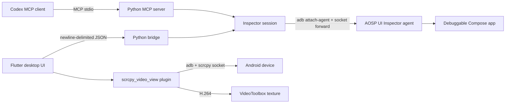

# Architecture

Recomposition Viewer consists of three deliberately separate layers. Keeping the
wire protocol, tree model, and video transport independent makes failures easier
to diagnose and lets the inspector backend run through either the desktop app or
MCP.

## Desktop UI

`app/lib/inspector_page.dart` owns the attach/capture lifecycle and composes the
hierarchy, details, and preview panes. Supporting files keep the algorithms that
need deterministic tests out of the widget:

- `models.dart` decodes backend snapshots.
- `hierarchy_projection.dart` filters, expands, and flattens the tree.
- `hierarchy_geometry.dart` computes reveal positions for deep selections.
- `preview_geometry.dart` maps device bounds into a fitted video frame.
- `preview_hit_testing.dart` selects the closest visible node.
- `scrcpy_session.dart` chooses the direct plugin path and compatibility path.
- `inspector_client.dart` owns the long-lived backend process and request IDs.

The UI must never assume that a node ID remains stable after navigation. It
reconciles selections using the reported tree/path and refreshes root IDs.

## Inspector backend

The Python backend stages the bundled agent artifacts into the debug app's
private `code_cache` directory using `run-as`, invokes Android's `attach-agent`,
and forwards the agent's abstract Unix socket to localhost. One persistent
session loads the View and Compose inspectors, starts counters, and requests
fresh trees.

The exact Compose inspector artifact is resolved from the local Gradle cache or
Google Maven after the device reports its Compose UI version. It is intentionally
not committed to this repository.

`bridge.py` exposes one JSON request/response per line for Flutter. `server.py`
exposes the same operations as MCP tools. Both use the session implementation in
`session.py`; behavior should not be duplicated between transports.

## Video path

The published `scrcpy_video_view` package starts the installed scrcpy server, reads its H.264
socket directly, and sends encoded frames to a native macOS VideoToolbox decoder.
Decoded frames are presented as a Flutter texture. The desktop app can fall back
to its older media-kit path when the direct protocol is incompatible.

scrcpy's server protocol is internal. Keep version discovery and failures
explicit, always remove ADB forwards and remote server processes on stop, and
retain the native application-termination cleanup hook.

## Resource lifecycle

Attach, capture, and preview are separate resources but the UI coordinates them:

1. Attach creates a backend session and automatically starts recomposition
   tracking.
2. Refresh reuses that session rather than reconnecting each second.
3. Detach stops tracking, closes the inspector socket, and removes its ADB
   forward.
4. Preview stop removes the scrcpy forward and server process.
5. Window termination performs best-effort cleanup for both paths.

New code that allocates a process, stream subscription, socket, timer, texture,
or ADB forward must define its owner and cleanup path.
